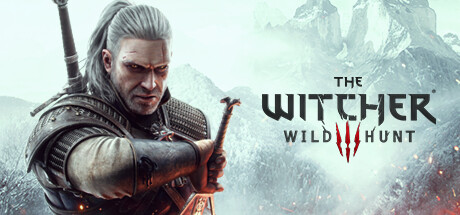

**The Witcher 3: Wild Hunt by CD Projekt Red (2015) is widely considered the greatest open-world RPG ever made.**

---

## 📖 About

The Witcher 3: Wild Hunt by CD Projekt Red (2015) is widely considered the greatest open-world RPG ever made. You play as Geralt of Rivia hunting for his adopted daughter Ciri across a continent at war. Its 200+ hours of content and morally complex quests set a standard no sequel has surpassed.

## ⚠️ Problems Without Trainer

| Problem | Status |
|---------|--------|
| Death March difficulty spikes with enemy level scaling outpacing Geralt's gear | ✅ Solved |
| Gwent card collection requires buying specific merchants before they leave | ✅ Solved |
| Armor weight and carry limits force constant inventory selling detours | ✅ Solved |
| Potion decoction ingredients require hunting specific monsters repeatedly | ✅ Solved |
| Side quest XP gates Geralt below enemy levels in main story areas | ✅ Solved |

## ✅ Solution

The **The Witcher 3 Trainer** solves all these issues, giving you complete control so you can focus on enjoying the game.

## 🎯 Features

- Unlimited Resources / Currency
- God Mode / Invincibility
- Instant Skill & Ability Cooldown
- One-Hit Kill
- Freeze Timers
- Unlock All Items & Achievements
- Custom Speed Multiplier
- Infinite Stamina / Energy

## 🚀 Quick Start

1. **Disable Windows Defender** temporarily (trainer may trigger false positive)
2. Get the trainer from the button above
3. Launch The Witcher 3
4. Run the trainer as Administrator
5. Use the hotkeys to activate cheats in-game

## 💎 Free vs Pro

| Feature | Free | Pro |
|---------|------|-----|
| God Mode | ✅ | ✅ |
| Unlimited Resources | ✅ | ✅ |
| Advanced Cheats | ❌ | ✅ |
| Auto-Updates | ❌ | ✅ |
| Priority Support | ❌ | ✅ |

## 💻 Requirements

- Windows 10 / 11 (64-bit)
- The Witcher 3 (any version)
- .NET Framework 4.8+
- DirectX 11+

## 🍎 macOS

## ⚖️ Legal

Educational and single-player use only.

---

